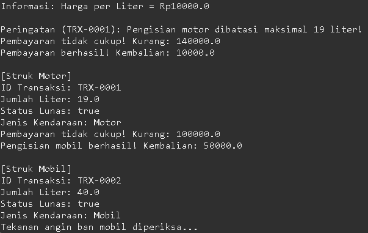

# Responsi PBO - Sistem SPBU

Repositori ini berisi kode sumber untuk sistem transaksi layanan SPBU berbasis Object-Oriented Programming menggunakan bahasa pemrograman Java. Proyek ini disusun untuk memenuhi penugasan responsi akhir Praktikum Pemrograman Berorientasi Objek.

## A. Identitas Mahasiswa
- **Nama:** Felix Ogen Gelael
- **NIM:** H1D025123
- **Tema Sistem:** SPBU

## B. Petunjuk Instalasi dan Eksekusi

Berikut adalah cara untuk mengunduh (*clone*), mengompilasi, dan menjalankan kode program ini melalui terminal atau *command prompt*:

**1. Clone Repositori**
```bash
git clone https://github.com/FelixOgenGelael/SPBU.git
```

**2. Masuk ke Direktori Proyek**
```bash
cd SPBU/SPBU/src
```

**3. Compile Kode Java**
```bash
javac main/*.java
```

**4. Jalankan Program**
```bash
java main.Main
```

## C. Screenshot Luaran Program

